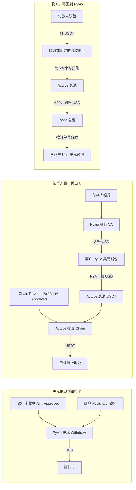
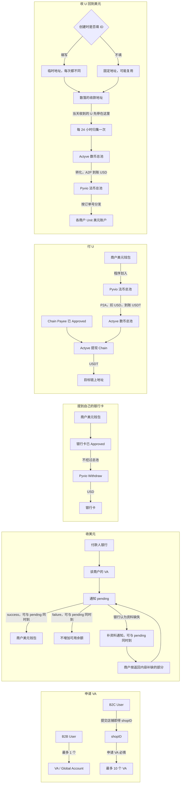

# 法币与 U 的资金路径

> 记录日期：2026-10-12，2026-10-13 会议补充。来源是 Pyvio / Actyve 公开文档，加上对方确认：P2A 打进 Actyve 后直接是 USDT；从 Actyve 回到 Pyvio 走提现（对方称为 A2P），到账是 USD。10 月 13 日会上又确认了开户、VA 数量、收款通知和两边总池的规则，见下文「2026-10-13 会议」。
>
> 这是以后做真实收付时的路径。当前仓库里的工作台仍是 2026-10-08 的模拟通道：页面上还有「法币钱包 + USDT 钱包」和自有账户划转，那是按更早的假设做的，不代表这条路径已经接上。

## 结论

商户长期只有 Pyvio 里的一个美元钱包。余额以这个钱包为准。

Pyvio（法币）和 Actyve（数币）各自有一个总池，用来在两边运钱。商户平时看到的仍是他自己的美元钱包。P 打到 A、A 打回 P，都只能走这两个总池，不能从某个商户的账户直接跨过去。这段运输只能由程序自动做，不能人工改总池里的钱，否则两边对不上账。

美元要离开这个钱包、回到一张银行卡时，走 Pyvio 自己的提现，不经过 Actyve。

Kaloq 自己记账：这笔钱属于哪个商户、发给谁、现在停在哪一步。Actyve 分不清商户。

上面这张是 10 月 12 日的总览。10 月 13 日会后，美元和 U 互转必须经过两边的总池，收款通知也要分开画。下面这张是按会上说法画的，实现时以这张为准。

图里出现多次的「商户美元钱包」是同一个钱包，「Pyvio 法币总池」是同一个池，「Actyve 数币总池」也是同一个池。提到银行卡不进这两个池。总池之间的运输只由程序自动执行。

收款人编号：我们生成 `partner_payee_id` 传给对方，对方返回 `payee_id`。银行卡和链上地址都是这样。

## 法币入金，再出 U

1. 付款人把美金电汇到该商户的 Pyvio 银行 VA。钱进入这个商户在 Pyvio 的美元钱包。机构模式下，这笔钱在商户自己的 Unit 里，请求要带该商户的 `X-Unit-Id`。
2. 目标链上地址先在 Actyve 登记并审核通过。接口是 `POST /actyve/api/v1/payee/chain/add`。提交的是对方已经在用的地址，Actyve 不新开地址。状态从 `Pending` 到 `Approved` 才能付；拒绝是 `Declined`，原因在通知的 `comments`。审核看的是地址是否允许付款（风险名单、制裁名单），不是往这个地址打一笔试探款。同一个地址过一次即可。员工自己的钱包类型填 `Non-Custodial`；交易所地址填 `Custodial`，并填写平台名，例如 `Binance`。是不是我们自己的地址用 `is_owner`：员工地址填 `N`。
3. 地址通过后，先用 Pyvio Transfer 将该商户 Unit 的美元划至 Pyvio 主 Unit，再从 **Pyvio 主 Unit** 发起 P2A 到 **Actyve 主账户**。P2A 是 Pyvio 的接口：先 `POST /user/api/v1/payee/create`（`payee_type=E-Wallet`，`payment_method=P2A`，`wallet_info.account_no` 填 Actyve 主账户登录邮箱），收款人变成 `Approved` 后再创建付款。2026-10-29 沙盒实测已用 已核验的 Actyve 主账户邮箱（账号标识脱敏） 创建并审核收款人，从 Pyvio 主 Unit 发起 `TARGET2ORIGIN` 的 1 USD 目标到账付款；Pyvio 返回扣款 4 USD、手续费 3 USD，付款 Mock 后订单 `Success`，主 Unit 可用余额相应减少。`ORIGIN2TARGET` 扣款 1 USD 被拒绝为 `B_Outbound_TargetAmountError`，因为不足以覆盖该次手续费。**Actyve 沙盒余额尚未出现 USDT**，所以跨平台到账与最终兑换关系仍需供应商确认，不能仅凭 Pyvio 订单成功认定 Actyve 已入池。
4. 再调 Actyve `POST /actyve/api/v1/withdraw/create`。`order_type` 填 `Chain`，`target_address` 填第 2 步同一个地址，`currency` 填 `USDT`。这个请求里没有 `payee_id`。钱从 Actyve 总池扣出。文档示例是转出 100 USDT，对方到账 99，手续费 1。成功后用 `chain_tx` 对账。

发多个人时，P2A 按工资总额打一次，然后每个已审核地址各提现一次。

## 美元提现到银行卡

这条只走 Pyvio，不经过 Actyve。钱从商户的美元钱包出来，打到一张银行卡，币种仍是法币。

1. 先创建银行收款人：`POST /user/api/v1/payee/create`。提到自己的银行卡时，`payee_type` 填 `BeneficiaryBankAccount`，`payment_method` 填 `Local` 或 `Swift`，并上传银行证明（字段 `reference`）。状态同样要到 `Approved` 才能付。
2. 再创建付款，`order_type` 填 `Withdraw`：从该商户 Pyvio 账户的可用余额提到这张卡。同币种时不用先换汇。机构模式下请求带该商户的 `X-Unit-Id`。

付给别人的银行卡是相邻的另一条：收款人类型用 `SupplierBankAccount`，付款的 `order_type` 用 `Payout`。那不是把 VA 里的钱提回自己的卡。

## 收 U，再回到 Pyvio

1. 向 Actyve 要这笔订单的收款地址。地址由对方生成。填写 ID 时每次都是新的临时地址；不填 ID 时可能复用，成为相对固定的地址。
2. 付款人把 USDT 打到这个地址。钱先停在这些零散地址上，不立刻进入总池，也不立刻变成商户的可用美元。
3. 每 24 小时归集一次，把当天各地址上的 U 收进 Actyve 的数币总池。
4. 再从 Actyve 总池转化到 Pyvio 法币总池，到账是 USD。这一步就是 A2P。
5. 按订单号把 Pyvio 总池里的美元分发到对应商户的 Unit 账户。分发完成，该商户的可用美元才增加。

归集、转化、分发都由程序按订单自动做，不人工逐笔划。

## 余额怎么显示

商户平时看到的是 Pyvio 美元余额。

P2A 已经扣款、链上还没打出，收来的 U 还在零散地址上或还没分发到 Unit，或者银行卡提现已提交、对方银行还没入账时，钱在路上。收 U 从打进地址到变成可用美元，中间最多要等一个归集周期。这段时间要显示一笔处理中金额。只显示 Pyvio 的最终余额，商户会看到钱突然少了，或收到的 U 还没出现。

三条路完成之后，商户名下仍然只有美元。提到银行卡的是法币，提到链上地址的 U 和刚收进来又划回 Pyvio 的美元，都不在 Actyve 里给这个商户留余额。

## 公开文档里已经核对过的接口

| 步骤 | 谁的接口 | 作用 |
|---|---|---|
| 收美元 | Pyvio VA / 收款通知 | 美金进入商户 Unit 的美元钱包 |
| 美元提到银行卡 | Pyvio 创建收款人 `BeneficiaryBankAccount`，再创建付款 `order_type=Withdraw` | 从美元钱包打到自己的银行卡，不经过 Actyve |
| 登记出 U 地址 | Actyve `POST /actyve/api/v1/payee/chain/add` | 保存并审核目标链上地址 |
| 美元打到总池 | Pyvio 创建收款人 + 创建付款，`payment_method=P2A` | 扣 USD，Actyve 到账 USDT |
| 把 U 打给目标 | Actyve `POST /actyve/api/v1/withdraw/create`，`order_type=Chain` | 从总池打到已审核地址 |
| 收一笔 U | Actyve 生成临时或固定地址 | U 先停在零散地址上 |
| 每 24 小时归集 | 程序把各地址上的 U 收进 Actyve 总池 | 不按单笔立刻进总池 |
| U 回到美元 | Actyve 总池 A2P 到 Pyvio 总池，再按订单号分发到 Unit | 分发完成后商户美元才可用 |

Pyvio 公开的电子钱包通道还有 GCash、PIX、DANA 等当地法币钱包。名单里没有币安，也没有「把美元打到任意链上地址」。打到币安充值地址仍然走 Actyve：Chain Payee 类型 `Custodial`，平台填 `Binance`，审核通过后再提现。

## 联调时还要按对方样例填的字段

这些不影响上面的路径，但写代码前要用对方给的请求样例对上字段名：

- A2P 使用 Actyve withdraw。公开文档里 `order_type` 的枚举是 `Chain`、`GlobalAccount`、`BankAccount`，没有一个叫 `A2P` 的值。Pyvio 账户地址填在哪个字段，以对方样例为准。会上确认这笔先回到 Pyvio 总池，再由程序记到该商户的美元钱包，不从商户账户直接跨到 Actyve。
- P2A 收款人样例里的 `account_country` 写了 `US`。公开文档里电子钱包的国家枚举只有 BD、BR、ID、MY、PH、PK。是否允许 `US`，以对方确认为准。
- 公司收款人要填 `company_name`。样例如果只填了 `first_name` / `last_name`，提交前改成公司字段。`partner_payee_id` 由我们自己生成并保存，`payee_id` 由对方生成后返回。若 `account_no` 是邮箱，补上 `wallet_account_type=email`。

## 2026-10-13 会议

和 Pyvio、Actyve 开会确认的内容。和上面冲突的地方，以这一节为准。

### 开户和 VA

创建 Pyvio User 时如果选 B2C，后续申请 `Collection` VA 必须带店铺 ID；创建 User 本身不填店铺 ID。User 审核通过后提交店铺，创建接口立即返回 `shopID`，无需等待店铺审核结束即可申请 VA，并在申请时带上这个 `shopID`。

VA 就是 Pyvio 的 Global Account。一个 B2B User 可以申请 1 个 VA。一个 B2C User 可以申请 10 个 VA。

### VA 收款通知

收美元时，通知顺序是先 `pending`，再 `success` 或 `failure`。也可能两条一起到：`pending` 加 `success`，或 `pending` 加 `failure`。处理时按同一笔收款归并，不要因为一起到就入两次账，也不要因为只有 `pending` 就把钱当成已经可用。

如果收款银行认为资料不够，会在 `pending` 之后再来一条补资料通知，也可能和 `pending` 一起到。这时让商户按返回内容补上缺的那部分，不是整套资料重交一遍。

Notify 有校验，用来发现漏掉的消息。过往消息可以用 Events 再查一遍。

### 两边的总池

法币总池在 Pyvio，数币总池在 Actyve。美元要变成 U，或 U 要变回美元，只能从总池进出。商户自己的美元钱包不直接连到 Actyve。

程序先在商户钱包和总池之间记账、划转，再由总池去对面对方总池。人不能手工改总池里的余额或补一笔运输。一旦手工干预，两边的账会对不上，而且很难补救。

### 收 U 的地址和归集

地址由 Actyve 生成，可以是临时的，也可以是固定的。创建时如果填写 ID，每次拿到的地址都不同。不填 ID，下次有可能拿到和上次相同的地址。

每天这些地址上会进来很多笔零散的 U。每 24 小时归集一次，先收进 Actyve 数币总池，再转化到 Pyvio 法币总池，然后按订单号分发到各个 Unit。商户的可用美元要等分发完成才增加。

### 收款人编号

`payee_id` 是对方生成的。`partner_payee_id` 是我们自己生成的本地编号，创建收款人时传过去，之后两边用它对应同一条收款人。
