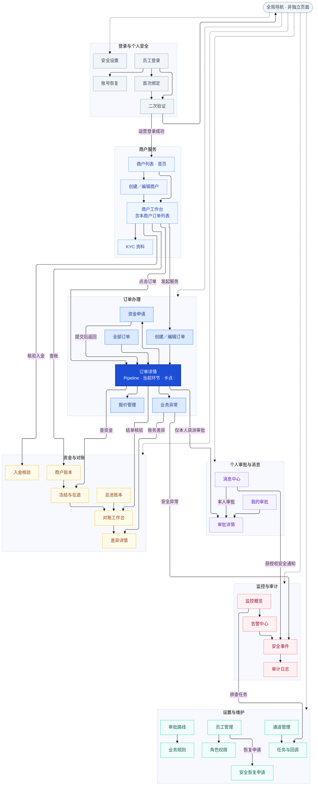

# Kaloq 内部版页面关系图

本图包含页面清单中的全部 35 种页面模板。运营从商户列表进入某商户服务工作台，在商户内看订单列表，进入订单详情查看 Pipeline、当前环节、停留时长、卡点原因及下一步操作。

- 方框为页面；模块大框为分组；“全局导航”为共有导航组件，不单独算页面。
- 实线为主要页面跳转；虚线为全局导航进入模块或安全设置的入口。所有入口按角色授权展示，导航不授予额外数据权限。
- 仅画主要跳转，返回上页、返回商户、通用个人菜单和全部列表筛选状态省略。商户页内订单列表和详情页内 Pipeline 不单独计页。
- 图中的箭头是页面关系，不是付款执行顺序。审批始终由指定员工办理，运营不可通过订单详情打开他人的专属审批。
- 蓝色为商户/订单，紫色为个人审批，金色为资金对账，红色为监控审计，青色为设置维护，灰色为账号安全。颜色表示页面分组，不表示通道或订单状态。

[页面清单及 Pipeline 详细要求](internal-v1-page-inventory.md) · [Mermaid 源文件](diagrams/internal-v1-page-map.mmd) · [可缩放 SVG](diagrams/internal-v1-page-map.svg) · [PNG](diagrams/internal-v1-page-map.png)

