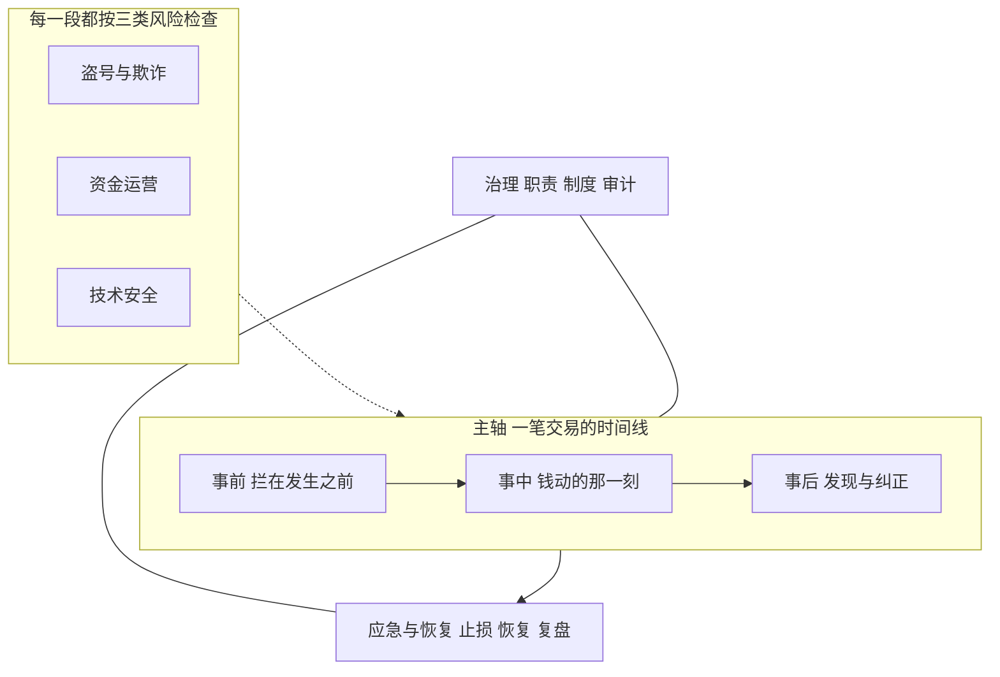
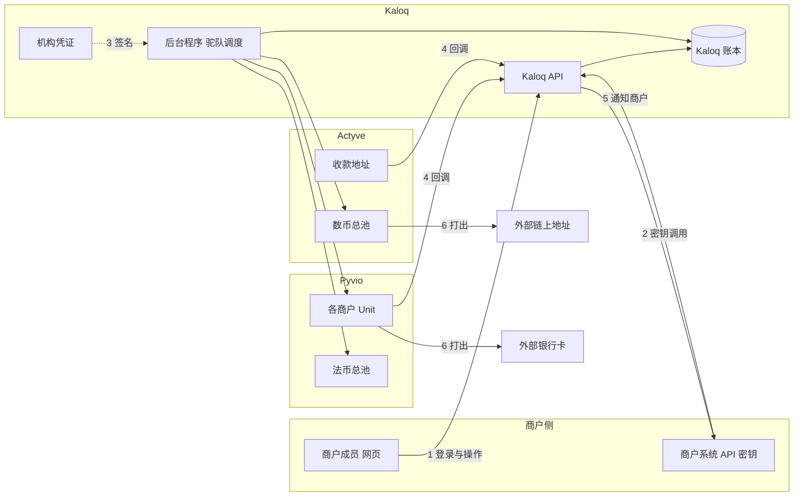
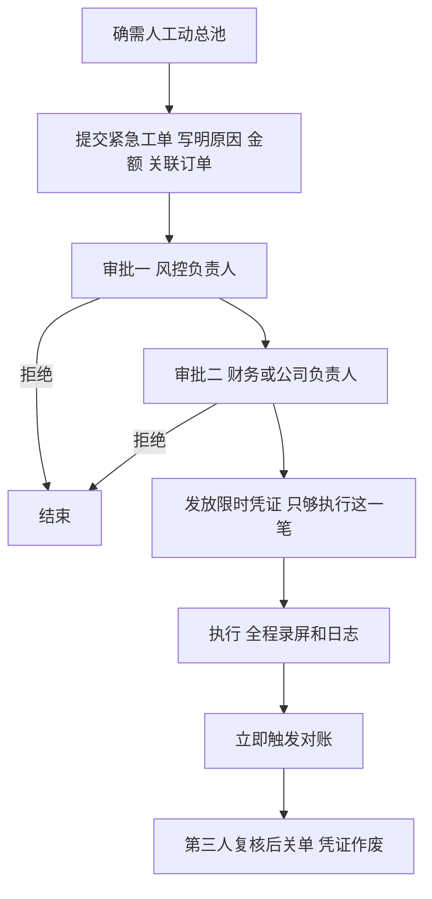
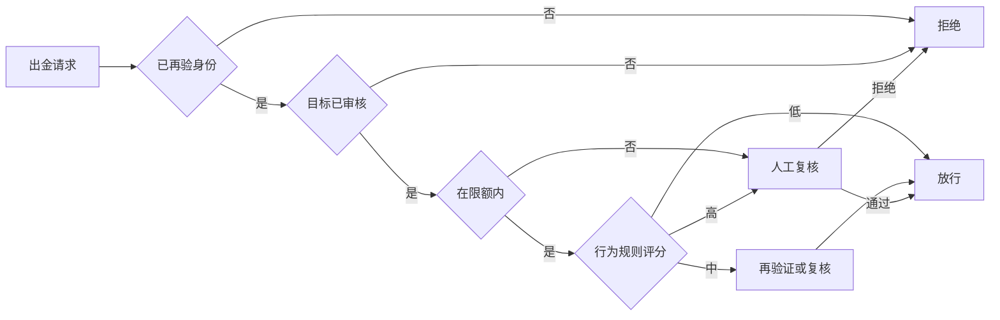
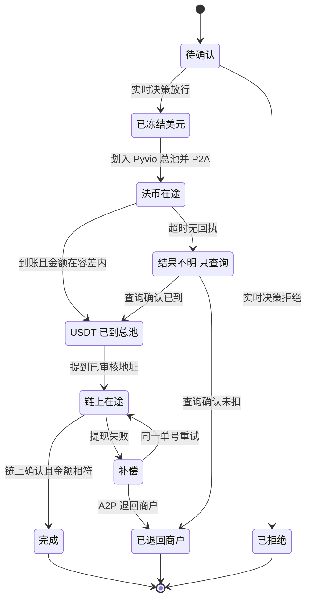
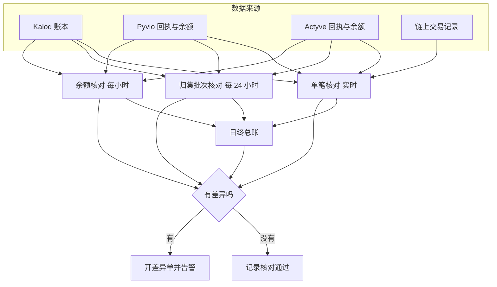
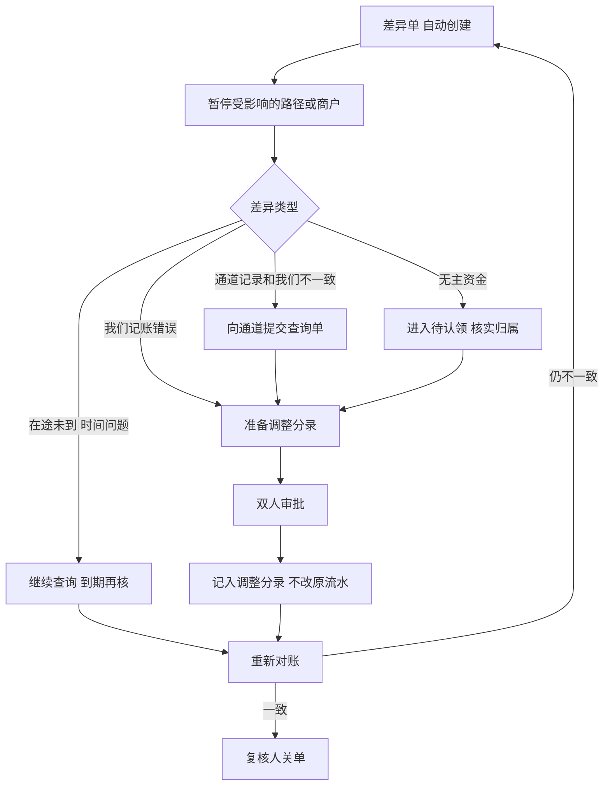

# 安全审计与风控方案

> 2026-11-04 适用性说明：下文为 2026-10-14 商户版历史风险研究，其中现状、角色、阈值与补偿示例需按 [D1 决策登记](day-01/decisions-and-readiness.md) 校正。正式内部版采用指定个人审批和受控执行，按 [最新对账签名方案](reconciliation-and-execution-integrity.md) 分资产、分资金位置记账及对账；未知结果先查询原单，退款或再次付款须另有授权。当前运行状态见 D1 核验记录。

> 2026-10-14。按 [法币与 U 的资金路径](fund-flow.md)（含 10 月 13 日会议）和当前仓库代码整理。本文只给结论和方案，没有改代码。
>
> 文中「现状」指当前仓库和演示服务器的实际情况。当前线上是模拟通道，没有接真实资金；标为「上线前必须」的项，要在接入真实 Pyvio / Actyve 之前做完。
>
> 本文只覆盖技术和业务层面的安全与风控。合规（反洗钱、制裁名单筛查、牌照、客户风险评级、可疑交易上报等）由合规同事另行负责。本文的实时决策（4.1）和暂停开关（7.1）可以作为合规规则的接入点。

## 结论

最大的风险集中在三处：

1. **机构密钥和两个总池。** 机构模式下，Kaloq 的一套 Pyvio / Actyve 凭证能操作所有商户的 Unit 和两边总池。这套凭证泄露，或者有人能绕开程序直接动总池，损失的是全部商户的钱，不是某一个商户。
2. **钱离开商户美元钱包的那一下。** 提现、付给他人、付 U 都从这里扣。账号被盗、付款目标被换、内部人员越权，都在这一步变成真实损失。
3. **两边总池之间的运输和归集。** Actyve 分不清商户，钱属于谁只有 Kaloq 账本说得清。一段运输失败、一笔入金没带订单号、24 小时归集后分发错了，都会出现「钱在池子里，但对不上是谁的」。

## 0. 框架

风控体系按三个维度搭：

- **主轴是一笔交易的时间线：事前、事中、事后。** 这是支付和金融行业最常用的风控骨架。事前对应预防，拦在发生之前；事中对应实时决策，钱动的那一刻判断该不该放；事后对应发现和纠正，事后查出问题并修复。
- **每一段都按三类风险各检查一遍：**
  - 盗号与欺诈：是不是本人，是不是本意。
  - 资金运营：钱有没有走对、有没有到、账对不对得上。
  - 技术安全：系统本身有没有被攻破。
- **底下垫两层不随交易发生的基础：**
  - 治理：谁负责，规则谁定、谁批、谁审计。
  - 应急与恢复：出事后怎么止损、怎么恢复。

各格的主要措施：

| | 盗号与欺诈 | 资金运营 | 技术安全 |
|---|---|---|---|
| **事前** | 二次认证、付款目标登记和冷静期、限额 | 职责分离、驼队只由程序控制、地址绑定订单 | 密钥管理、环境隔离、回调验签、服务器加固 |
| **事中** | 每笔出金实时评分，决定放行、加验、复核或拒绝 | 分段计时、结果不明只查询、自动补偿 | 系统指标监控、验签失败告警 |
| **事后** | 盗号事件追溯、规则迭代 | 四层对账、差异单、调整分录双人审批 | 审计日志防篡改、安全复盘 |

第 3 到 5 章按这张表展开，第 6、7 章是治理和应急。

## 1. 保护对象和威胁来源

| 保护对象 | 为什么重要 |
|---|---|
| 商户美元余额 | 每个商户在 Pyvio 自己 Unit 里的钱 |
| Pyvio 法币总池、Actyve 数币总池 | 所有商户共用的运输资金，一出问题影响全部商户 |
| 机构凭证 | Pyvio、Actyve 的 app_id、app_secret、签名私钥。能代表 Kaloq 操作所有 Unit 和总池 |
| Kaloq 账本 | 唯一能说清总池里每一分钱属于哪个商户、哪一笔订单 |
| 付款目标 | 银行卡收款人、链上收款人。被换掉等于钱打给了别人 |
| KYC 资料 | 企业证件、受益人信息，泄露会伤害商户，也有法律责任 |
| 回调和通知 | 通道告诉我们「到账了」「失败了」。被伪造等于凭空加钱 |

| 威胁来源 | 典型情况 |
|---|---|
| 外部攻击者 | 盗商户账号、盗 API 密钥、伪造通道回调、攻击服务器 |
| 商户内部人员 | 操作员越权付款、离职员工的账号没停用 |
| Kaloq 内部人员 | 有数据库或服务器权限的人改账、手工动总池 |
| 通道自身 | 回调延迟、重复、乱序、漏发，扣款成功但另一边没到账 |
| 链上 | 打错链、打错币、少付、粉尘地址 |

下图标出了钱和指令跨越的边界。编号 1 到 6 是主要的攻击面。

## 2. 全流程安全审计

等级：**高**是会直接造成资金损失或全量数据泄露；**中**是需要条件配合才会出事，或者损失有限；**低**是改进项。类型对应第 0 章的三类风险。

### 2.1 登录与会话

| 风险 | 类型 | 后果 | 现状 | 等级 |
|---|---|---|---|---|
| 只有邮箱和密码，没有第二重认证 | 欺诈 | 密码被撞库或钓鱼后，攻击者能直接发起出金 | 密码用 scrypt 加密存储，邮箱不存在时也做了等时校验。没有二次认证 | 高 |
| 没有登录限速和锁定 | 欺诈 | 可以无限次猜密码 | 没有 | 高 |
| 会话 7 天有效，令牌存在浏览器 localStorage | 技术 | 页面一旦被注入脚本，令牌能被直接读走，并且长期有效 | 是 | 中 |
| 邀请链接拿到就能加入 | 欺诈 | 链接被转发或泄露，陌生人就能以该角色加入商户 | 7 天有效、只能用一次，没有校验接受人邮箱 | 中 |
| 没有异常登录提醒 | 欺诈 | 新设备、新地区登录，管理员不知道 | 没有 | 中 |

### 2.2 权限与 API 密钥

| 风险 | 类型 | 后果 | 现状 | 等级 |
|---|---|---|---|---|
| 一个人就能发起并完成一笔出金 | 欺诈 | 单个账号被盗或内部作恶，没有第二个人拦 | 角色有管理员、操作员、查看者，后端每次请求都校验。没有双人复核 | 高 |
| 可动资金的 API 密钥没有限制 | 欺诈 | 密钥泄露后可以从任何地方、任意金额付款 | 密钥分只读和可动资金两种，没有 IP 白名单、金额上限 | 高 |
| 管理员权限过大 | 欺诈 | 管理员一个人能邀请新人、建密钥、改通知地址、付款 | 是。已经有「最后一个管理员不能被移除」的保护 | 中 |

### 2.3 开户与 KYC 资料

| 风险 | 类型 | 后果 | 现状 | 等级 |
|---|---|---|---|---|
| 资料加密密钥和数据库放在同一台机器、同一个配置文件里 | 技术 | 服务器被攻破，加密等于没加 | KYC 快照和附件用 AES-256-GCM 加密，撤回授权会删除，查看完整资料会留审计 | 中 |
| 补资料通知被伪造 | 欺诈 | 骗商户上传敏感文件到错误地方 | 真实通道回调还没接 | 中 |

### 2.4 收美元

| 风险 | 类型 | 后果 | 现状 | 等级 |
|---|---|---|---|---|
| 把 `pending` 当成到账 | 运营 | 钱没真正到就让商户用掉了 | 模拟通道里待结算不进可用余额 | 高 |
| `pending` 和 `success`、`failure` 一起到，或乱序到 | 运营 | 重复入账或状态回退 | 回调按事件编号去重。真实通道还没接，乱序处理要按会议结论实现 | 中 |
| 银行要求补资料时迟迟不补 | 运营 | 钱一直卡住，可能被退回 | 没有提醒机制 | 中 |
| 汇款被付款行撤回 | 欺诈 | 已入账的钱被扣回，商户可能已经花掉 | 没有处理流程 | 中 |

### 2.5 收 U 与归集

| 风险 | 类型 | 后果 | 现状 | 等级 |
|---|---|---|---|---|
| 创建地址不带订单号，地址被复用 | 运营 | 两笔入金落到同一地址，分不清属于哪笔订单甚至哪个商户 | 还没接 | 高 |
| 少付、多付、打错币、打错链、过期后才付 | 运营 | 按全额入账会多给钱；不处理会变成无主资金 | 还没接 | 高 |
| 分发到 Unit 时订单号对错 | 运营 | 钱进了别的商户 | 还没接 | 高 |
| 24 小时归集前钱散在大量地址上 | 运营 | 一个归集批次出错，影响当天所有收 U | 还没接 | 中 |
| 粉尘入金 | 运营 | 大量极小额入金拖慢对账 | 还没接 | 低 |

### 2.6 提现到银行卡、付给他人

| 风险 | 类型 | 后果 | 现状 | 等级 |
|---|---|---|---|---|
| 收款银行卡被换成攻击者的卡 | 欺诈 | 钱打给了别人 | 模拟版直接填目标信息，没有收款人登记和冷静期 | 高 |
| 没有限额 | 欺诈 | 一次被盗就能清空余额 | 没有 | 高 |
| 重复提交 | 运营 | 同一笔付了两次 | 已有幂等键，同一请求号只执行一次 | 低 |
| 结果不明时重试 | 运营 | 实际已付成功又再付一次 | 已实现：结果不明只查询，不重新提交 | 低 |

### 2.7 付 U

付 U 有两段：先把美元从商户钱包划进 Pyvio 总池，经 P2A 到 Actyve 总池变成 USDT，再从 Actyve 总池提到目标地址。

| 风险 | 类型 | 后果 | 现状 | 等级 |
|---|---|---|---|---|
| 第一段成功、第二段失败 | 运营 | 商户美元已扣，U 停在 Actyve 总池，没打出去也没退回 | 还没接 | 高 |
| 目标地址被替换，或复制粘贴时被换 | 欺诈 | U 打给了攻击者，链上无法撤回 | 还没接 | 高 |
| 实际到账 USDT 和报价差太多 | 运营 | 商户或平台亏汇差 | 还没接 | 中 |
| Actyve 总池 USDT 不够 | 运营 | 提现失败，订单卡住 | 还没接 | 中 |
| 打错链 | 运营 | 资金丢失 | Actyve 收款人审核会校验地址，链和地址要一起校验 | 中 |

### 2.8 两个总池（驼队）

| 风险 | 类型 | 后果 | 现状 | 等级 |
|---|---|---|---|---|
| 有人能手工划转总池 | 运营 | 绕开订单动钱，两边账再也对不上 | 还没接。会上已确认驼队只能程序控制 | 高 |
| 总池里有说不清属于谁的钱 | 运营 | 无主资金，或被挪用而不被发现 | 还没有对账 | 高 |
| 机构凭证泄露 | 技术 | 一把钥匙能动全部商户的钱和两个总池 | 本机 `apps/api/.env` 里放着 Pyvio 文档测试账号的私钥（已被 git 忽略）。生产凭证还没有专门的密钥管理 | 高 |
| 总池被程序错误地反复划转 | 运营 | 程序缺陷放大成大额损失 | 任务队列已有去重键和重试上限 | 中 |

### 2.9 通道回调

| 风险 | 类型 | 后果 | 现状 | 等级 |
|---|---|---|---|---|
| 伪造 Pyvio 或 Actyve 回调 | 技术 | 凭空给商户加钱，或把成功改成失败 | 模拟通道验签已测。真实 Pyvio 验签没实现，还没拿到 Pyvio 公钥。Actyve 回调入口还没有 | 高 |
| 重放旧回调 | 技术 | 同一笔钱入账两次 | 按事件编号去重 | 中 |
| 回调漏发 | 运营 | 钱到了但系统不知道 | 会上确认 Notify 有校验、可用 Events 补查。我们这边还没做定时补查 | 中 |

### 2.10 Kaloq 对外 API 和通知

| 风险 | 类型 | 后果 | 现状 | 等级 |
|---|---|---|---|---|
| 通知地址可以填内网地址 | 技术 | 服务器被借用去访问内部服务，例如 127.0.0.1:4100 | 只检查是不是 http 或 https，允许 http，没有拦内网地址 | 高 |
| 通知签名密钥明文存数据库 | 技术 | 数据库泄露后，攻击者能伪造 Kaloq 发给商户的通知 | 是 | 中 |
| 通知地址被改成攻击者的 | 欺诈 | 商户收不到真实结果，攻击者拿到交易信息 | 改通知地址只需要管理员权限，不需要再验身份 | 中 |

### 2.11 服务器与部署

| 风险 | 类型 | 后果 | 现状 | 等级 |
|---|---|---|---|---|
| 演示站和以后的生产环境混用 | 技术 | 模拟通道、演示数据开关、公开账号带进生产 | 演示站 `v-2077.com/kaloq` 用模拟通道。README 里写着演示账号和密码 | 高 |
| 服务以 root 运行 | 技术 | 程序被攻破就等于整台服务器被攻破 | 是 | 高 |
| 和其他网站共用一台服务器 | 技术 | 任何一个站被攻破都会波及 Kaloq | 是 | 中 |
| 数据库密码简单，没有加密备份 | 技术 | 数据库被拿到或丢失 | 是 | 中 |
| 没有对登录和资金接口做访问频率限制 | 技术 | 被刷接口 | 前面有 Cloudflare，但应用和 Nginx 没设频率限制 | 中 |

### 2.12 治理与内部人员

| 风险 | 类型 | 后果 | 现状 | 等级 |
|---|---|---|---|---|
| 有数据库权限的人直接改余额 | 运营 | 账本被篡改且难以发现 | 审计日志是普通数据库表，有权限的人可以改 | 高 |
| 没有运营对账和人工处理工具 | 运营 | 出了差异只能直接改数据库，正好违反「驼队不能人工动」 | 没有 | 高 |
| 写代码、部署、批资金操作是同一批人 | 运营 | 没有人能独立拦住错误或作恶 | 团队早期，是 | 中 |
| 生产服务器多人共用 root 登录 | 技术 | 出事后查不到是谁做的 | 是 | 中 |

## 3. 事前：拦在发生之前

原则：**动钱的指令只有两个来源。** 一是商户成员或商户系统，对自己的美元钱包发起；二是 Kaloq 后台程序，按已确认的订单操作总池。运营人员不在这两条路上。

### 3.1 盗号与欺诈

**身份认证**

- 所有管理员、所有能动资金的成员，都开启二次认证。用验证器 App，短信只作备用。
- 会话缩短。网页闲置 30 分钟退出，最长 12 小时必须重新登录。令牌改成浏览器读不到的 Cookie，不放在 localStorage。
- 登录失败限速。同一账号连续失败 5 次锁 15 分钟；同一 IP 短时间大量失败，直接拦截。
- 新设备、新国家登录，通知该成员和所有管理员。
- 邀请链接只能由被邀请的那个邮箱接受。接受时验证一次邮箱验证码。

关键操作要**再验一次身份**，即使已经登录：

| 操作 | 为什么 |
|---|---|
| 发起提现、付给他人、付 U | 钱会离开商户钱包 |
| 添加或修改银行卡收款人、链上收款人 | 决定钱打到哪里 |
| 创建可动资金的 API 密钥 | 等于发出一把能付款的钥匙 |
| 修改通知地址 | 决定结果通知发给谁 |
| 邀请管理员、把成员升为管理员 | 扩大最高权限 |
| 关闭二次认证、重置密码 | 削弱认证本身 |

**付款目标管控**

付款目标指提现的银行卡、付给他人的银行卡、付 U 的对方链上地址。收款用的 VA 和收 U 地址由 Pyvio、Actyve 生成，Kaloq 不生成任何地址，所以不在这里。

- 新增或修改付款目标要再验身份，提交给通道审核。通道审核通过之前不能付款。
- 通道审核通过后，再加一段 **冷静期**，例如 24 小时。冷静期内可以付，但上限很低，或者必须复核。
- 新增目标时，通知该商户的所有管理员。
- 付款时只能从已登记的目标里选，不能当场手填地址。确认页完整显示地址的前几位和后几位，以及目标名称。
- 第一次向某个目标付款，金额设上限，或者强制复核。

**限额与频率**

| 维度 | 建议 |
|---|---|
| 单笔上限 | 按商户设定 |
| 每日累计 | 按商户设定，超过当天自动暂停该商户出金 |
| 单个目标每日累计 | 防止被盗后集中打到一个地址 |
| 新目标 | 冷静期内单独一个更低的上限 |
| 频率 | 同一商户短时间内连续多笔，降速或要求复核 |

**API 密钥**

- 可动资金的密钥必须绑定来源 IP，单独设定每笔和每天上限，只能付给已经审核通过的收款人。
- 密钥 90 天轮换。查看者、只读密钥任何情况下都不能发起资金操作，现在已经是这样，继续保持。

### 3.2 资金运营

**职责分离**

- 新增一个「复核人」权限。超过设定金额的出金，必须由发起人以外的第二个人复核后才执行。发起人和复核人不能是同一个人。
- 商户可以自己设定复核门槛。Kaloq 给一个默认值，例如单笔 1 万美元或当天累计 3 万美元，由业务和风控确定。

**驼队（两个总池）**

- 总池只能由后台程序操作。程序用的凭证只授予后台服务，不授予任何人，不出现在网页或运营界面上。
- 程序动总池必须带着一笔已确认的商户订单。没有订单、或金额和订单不一致，程序拒绝执行。
- 运营界面对总池只有两个按钮：**查看**和**暂停**。暂停只停止新的运输，不移动任何钱。

如果真的要人工动总池，例如通道事故后要把一笔钱退回商户，走紧急变更流程：

规则：提交人不能审批自己的工单；两名审批人不能是同一个岗位；凭证只在这一笔、短时间内有效；事后必须对账一致才能关单。人工操作在账本里记成单独的「调整分录」，不改原来的流水。

**入账规则**

- 收 U 创建地址时，始终带上 Kaloq 自己的订单号，并在 Kaloq 里把地址和商户绑定。同一地址出现在另一个商户名下时，系统拒绝。
- 收美元只有 `success` 才增加可用余额，`pending` 只显示为处理中。

### 3.3 技术安全

- **机构凭证**放进密钥管理服务，不放 `.env`。服务器上只在内存里出现，按时轮换，并向 Pyvio、Actyve 报 IP 白名单。能动钱的凭证和只读凭证分开，对账和监控只用只读凭证。
- **KYC 加密密钥**同样放进密钥管理服务，不和数据库放在一起。
- **环境隔离**：生产和演示完全分开。生产启动时禁止模拟通道、演示数据开关和演示账号。
- **回调验签**：Pyvio、Actyve 回调用对方公钥验签名，检查时间戳在几分钟以内，只接受对方 IP 段。验不过一律拒收。
- **对外通知**：通知地址只允许 https，拦截内网和本机地址。签名密钥加密存储。
- **服务器**：服务改为普通用户运行；生产服务器独立，不和其他网站共用；运维通过跳板机登录，每人独立账号；数据库强密码，备份加密。
- **接口频率限制**：登录和资金接口在 Nginx 或应用层限速。

## 4. 事中：钱动的那一刻

### 4.1 实时决策：这笔该不该放

每一笔出金，在真正调用通道之前，都按顺序过一遍判断。这是事中风控的核心，管的是盗号和误操作。合规方案如果需要拦截，也接在这里。

行为规则举例。命中后按严重程度处理：放行并记录、要求复核、暂停这一笔。

| 规则 | 处理 |
|---|---|
| 新设备或新国家登录后，24 小时内发起大额出金 | 要求复核 |
| 付款目标刚过冷静期就打出大额 | 要求复核 |
| 金额明显高于该商户过去 30 天的平均水平 | 要求复核 |
| 短时间内把一笔大额拆成多笔小额 | 暂停并告警 |
| 非常用时段的大额出金 | 要求复核 |
| 修改通知地址或新建资金密钥后，紧接着大额出金 | 暂停并告警 |
| 同一个付款目标出现在多个商户名下 | 告警给风控 |

规则阈值要能按商户单独调整。

### 4.2 资金运营监控：每一笔走到哪了

原则：**每笔订单拆成几段，每段都有一个期望完成时间。** 超过就升级，不等商户来问才发现。

下表的时间是建议初值。联调后，按每段真实耗时的 95% 分位数重新设：超过 2 倍关注，超过 4 倍告警。

| 路径 | 环节 | 关注 | 告警 | 紧急 |
|---|---|---|---|---|
| 付 U | 放行后，美元划进 Pyvio 总池 | 5 分钟未完成 | 15 分钟未完成 | — |
| 付 U | P2A 到 Actyve 总池，到账 USDT | 超过正常耗时 2 倍 | 回执失败 | 美元已扣、USDT 1 小时未到 |
| 付 U | 从 Actyve 总池提到目标地址 | 30 分钟未上链 | 提现失败 | USDT 已在总池但 2 小时未打出也未退回 |
| 收 U | 地址收到入金后等待归集 | — | 超过 26 小时未归集 | 归集批次失败 |
| 收 U | 归集后转化到 Pyvio 总池 | 超过正常耗时 2 倍 | 转化失败 | — |
| 收 U | Pyvio 总池分发到商户 Unit | 超过正常耗时 2 倍 | 分发失败 | 有钱分发不出去，找不到订单 |
| 收 U | 入金没有对应订单号 | — | 立即进待认领队列 | 待认领超过 24 小时 |
| 收美元 | `pending` 之后等待结果 | 3 个工作日 | 5 个工作日 | — |
| 收美元 | 收到补资料通知 | 立即提醒商户 | 2 个工作日未补 | — |
| 提现 / 付他人 | 等待银行到账 | 3 个工作日 | 失败 | 结果不明超过 24 小时 |
| 任何路径 | 通道结果不明 | 立即开始查询 | 查询 3 次仍不明 | 涉及已扣款且超过 24 小时 |

付 U 的每一步都有出口。卡住只会进入「结果不明」或「补偿」，不会悄悄停在中间：

补偿和退回也都由程序按同一单号执行，不由人工操作总池。

### 4.3 系统与技术监控

| 指标 | 为什么看 | 异常信号 |
|---|---|---|
| 回调验签失败数 | 有人在伪造回调 | 出现任何一次就告警 |
| 回调延迟 | 通道变慢或漏发 | 和平时相比明显变慢 |
| 各通道失败率 | 通道故障 | 突然升高 |
| 后台任务积压 | 程序卡住 | 待执行任务持续增加 |
| Actyve 总池 USDT 余额 | 不够就付不出 U | 低于未来 24 小时预计付出量 |
| Pyvio 总池余额 | 应该只有在途的钱 | 长时间不归零，或比在途订单多 |
| 汇率偏离 | 报价和实际成交差太多 | 超过设定点差 |
| 登录失败、二次认证失败 | 撞库、盗号 | 突然增多 |
| 新增付款目标数量 | 账号被盗后常见的第一步 | 某个商户短时间新增多个 |
| 待认领入金 | 收 U 对不上订单 | 出现就提醒 |

### 4.4 告警分级

| 级别 | 含义 | 谁收到 | 响应时间 | 系统自动做什么 |
|---|---|---|---|---|
| 关注 | 比平时慢，还没出问题 | 值班群 | 当天看 | 继续查询 |
| 告警 | 有一段失败或明显超时 | 值班人员电话或 IM 提醒，以及商户管理员 | 30 分钟内 | 暂停这一笔后续步骤，转人工确认 |
| 紧急 | 钱已经离开一边、另一边没到，或总池对不上 | 值班人员、风控负责人、技术负责人 | 10 分钟内 | 暂停相关路径的新订单 |

告警要有人确认收到。没人确认，按时间自动升级到上一级。

## 5. 事后：发现与纠正

### 5.1 对账：三本账和链上要对得上

原则：

- 每一笔钱都在三个地方留下记录：Kaloq 账本、Pyvio、Actyve。U 的部分还有链上记录。链上是独立证据，不只信通道回执。
- 对账全部自动做。人只处理差异，不靠人工翻表核对。
- 发现差异不改数字，只开差异单。修正走单独的调整分录，并且要双人审批。

**四层对账**

| 层 | 频率 | 对什么 |
|---|---|---|
| 单笔核对 | 每一段完成时实时做 | 这一段出去的钱和那一边到的钱是否一致 |
| 归集批次核对 | 每次归集后，即每 24 小时 | 当天散地址收到的 U，是否全部归集、转化、分发 |
| 余额核对 | 每小时 | 每个商户的余额，以及两个总池的余额 |
| 日终总账 | 每天一次 | 所有商户、所有在途、所有手续费的总账，加上链上核对 |

**必须成立的等式**

单笔：

- 付 U 第一段：Pyvio 扣掉的美元 × 成交汇率 − P2A 费用 = Actyve 总池收到的 USDT。允许的误差只来自汇率和费用表。
- 付 U 第二段：Actyve 提现的 USDT − 提现费用 = 链上目标地址实际收到的 USDT。用 `chain_tx` 到链上查，不只看 Actyve 回执。
- 提现到银行卡、付给他人：商户扣掉的美元 = 付款金额 + 费用。
- 收美元：`success` 的金额 = 该商户 Unit 增加的美元。

归集批次：

- 当天各收款地址收到的 USDT 合计 = 归集进 Actyve 总池的 USDT + 归集费用。
- 归集的 USDT × 成交汇率 − 转化费用 = 到 Pyvio 总池的美元。
- 到 Pyvio 总池的美元 − 平台手续费 = 分发到各商户 Unit 的美元合计。
- 每一笔分发都能对应到一笔收 U 订单。对应不上的进待认领。

余额：

- 每个商户：Kaloq 账本里的可用 + 冻结 = Pyvio 该 Unit 的余额。
- 两个总池：Pyvio 总池余额 + Actyve 总池余额（按当时汇率折算）+ 还没归集的散地址余额 = Kaloq 账本里所有在途订单金额 + 平台自有资金 + 还没结算的手续费 + 待认领金额。

最后这条最关键。两个总池里的每一分钱，都必须能说清楚属于哪一笔订单，或者是平台自己的钱。说不清的就是差异。

举例：数币那边进了 50，法币这边只到了 30。按上面的等式，归集批次那一层会立刻不平，差 20，开差异单并告警。在查明之前，相关路径暂停新订单。

**容差**

| 情况 | 容差 |
|---|---|
| 同币种 | 0。一分钱不差 |
| 美元和 USDT 互转 | 只允许报价汇率加合同里的点差上限，超出就是差异 |
| 费用 | 按合同费率表计算，和实际扣的不一致就是差异 |
| 链上手续费 | 按该链当时的实际网络费，单独记账，不混进汇差 |

**差异处理**

- 每张差异单写明：哪一层发现的、金额、涉及订单、涉及商户、发现时间。
- 差异单有时限。超过时限未处理，自动升级告警。
- 每天出一份对账报告：通过多少笔、差异多少笔、未关闭的差异金额、待认领金额、两个总池的期末余额。

### 5.2 撤回、退款和错转

| 情况 | 处理 |
|---|---|
| 收到的美元汇款被付款行撤回 | 先扣商户可用余额；不够扣的记为商户欠款，暂停该商户出金 |
| 收 U 少付 | 按实际到账金额入账，订单标记少付，通知商户 |
| 收 U 多付 | 按实际到账入账，或按约定退回多出部分，退回只能退到原地址 |
| 收 U 打错币、打错链 | 按 Actyve 的找回流程处理，结果不确定时不入账，进待认领 |
| 付 U 打到错误地址 | 链上无法撤回，只能联系对方；这正是事前目标管控要防住的情况 |
| 付给银行卡后发现是诈骗 | 通过 Pyvio 发起追回，成功率不确定 |

### 5.3 审计日志

- 登录、权限变更、付款目标变更、每一笔资金操作、每一次实时决策结果、每一次暂停和恢复、每一次人工审批，都写审计日志。
- 审计日志只能追加，不能修改和删除。每条记录带上一条的哈希，被改过能查出来。日志定期另存一份到 Kaloq 数据库之外。
- 生产数据库的写权限只给程序。人只能通过有审批的工具操作，不能直接改表。

### 5.4 复盘和规则迭代

- 每次告警、差异、安全事件关闭后，写简短复盘：原因、损失、为什么事前和事中没拦住、要改什么。
- 每月看一次规则效果：哪些规则误报太多，让正常商户被打扰；哪些事件没有任何规则命中。据此调阈值、加规则、删规则。
- 规则的每次变更都要记录谁改的、为什么改，并由第二个人批准。

## 6. 治理

治理回答的是：谁对风险负责，规则谁定、谁批，谁来检查做得对不对。

### 6.1 三道防线

行业里通常把风险管理分成三道互相独立的防线：

| 防线 | 谁 | 做什么 |
|---|---|---|
| 第一道 | 业务和运营、开发 | 日常执行流程，按规则处理告警和差异 |
| 第二道 | 风控 | 定规则、定限额、批例外、监督第一道 |
| 第三道 | 内部审计或外部审计 | 定期独立检查前两道是否真的在执行 |

团队小的时候不可能三道都配专人，但至少做到：**写代码和部署的人，不能同时是批准资金操作和规则变更的人。** 第三道可以每年请外部机构做一次安全审计。

### 6.2 角色和职责

| 角色 | 负责 |
|---|---|
| 风控负责人 | 风控规则和限额、紧急变更审批、暂停与恢复 |
| 技术负责人 | 系统安全、密钥管理、故障处理 |
| 财务 | 日终对账报告、差异单关闭的复核 |
| 值班 | 7×24 接收告警，按预案处置，按时升级 |

一个人可以兼任多个角色，但紧急变更流程里的两名审批人必须来自不同角色。

### 6.3 制度清单

| 制度 | 内容 |
|---|---|
| 限额制度 | 默认限额、复核门槛、例外审批 |
| 权限管理制度 | 谁能申请什么权限、谁批准、多久复核一次 |
| 密钥管理制度 | 密钥生成、存放、使用、轮换、泄露处置 |
| 变更管理制度 | 代码上线、规则修改、配置修改的审批和记录 |
| 应急预案 | 见第 7 章 |
| 数据保护制度 | KYC 资料的访问、加密、删除 |

### 6.4 内部人员和第三方

- 最小权限：每个人只拿完成工作需要的权限。生产数据库只读权限也要单独审批。
- 权限每季度复核一次。员工离职当天收回所有账号和密钥。
- 生产访问通过跳板机，每人独立账号，操作全程记录。
- 和 Pyvio、Actyve 书面约定：服务可用率、故障通知时限、安全事件通知时限、对账文件格式和提供时间。

## 7. 应急与恢复

对账和监控能发现问题，但不能止损。应急解决的是出事以后怎么尽快停下来、怎么恢复。

### 7.1 暂停开关

| 范围 | 谁能打开 | 恢复需要 |
|---|---|---|
| 某一个付款目标 | 风控值班 | 风控负责人 |
| 某一个商户的出金 | 风控值班、该商户管理员 | 风控负责人 |
| 某一条路径，例如全部付 U | 风控负责人 | 风控负责人和技术负责人两人 |
| 全部资金操作 | 风控负责人、技术负责人 | 两人共同确认，并完成一次对账 |

暂停只阻止新的运输。已经在途的订单继续由程序按状态走完，或进入补偿。暂停不移动任何钱。

### 7.2 场景预案

| 场景 | 第一动作 | 后续 |
|---|---|---|
| 机构凭证疑似泄露 | 暂停全部资金操作；通知 Pyvio、Actyve 冻结或作废凭证 | 换新凭证；全量对账；查泄露途径 |
| 商户账号被盗 | 暂停该商户出金；强制该商户所有成员下线 | 联系商户确认；核对被盗期间的操作和新增目标；能追回的发起追回 |
| 发现伪造回调 | 拒收并告警；暂停受影响路径 | 用通道查询接口核实所有近期回调；查验签为什么没拦住 |
| 总池对不上 | 暂停相关路径新订单 | 按差异处理流程；必要时走紧急变更 |
| 通道宕机 | 暂停对应路径，页面提示商户 | 在途订单只查询不重发；恢复后补查回调并对账 |
| 服务器被入侵 | 暂停全部资金操作；隔离服务器 | 轮换所有密钥；从干净备份重建；全量对账；评估数据泄露 |
| KYC 资料泄露 | 查明范围，止住泄露 | 通知受影响的商户 |
| 分发到了错误的商户 | 暂停相关商户出金 | 走调整分录双人审批，把钱转回正确商户；通知双方 |

每个预案写明：谁判断触发、谁执行、多久内完成第一动作、通知谁。

### 7.3 备份和恢复

- 数据库每天全量备份，持续保存增量日志。备份加密，异地另存一份。
- 设定恢复目标：最多丢多少分钟的数据，多久能恢复服务。数字由业务定，例如最多丢 5 分钟、4 小时内恢复。
- 账本是资金真相，恢复后必须先和通道全量对账，对平了才能重新开放资金操作。

### 7.4 演练

每季度选一个场景做一次演练，例如模拟凭证泄露、通道宕机、总池对不上。检查预案能不能执行、各人知不知道该做什么、暂停开关能不能真的停下来。

## 8. 按优先级的改进清单

### 上线真实资金前必须完成

1. Pyvio、Actyve 回调都要验签，检查时间戳，只接受对方 IP 段。
2. 机构凭证放进密钥管理服务，不放 `.env`。能动钱的凭证和只读凭证分开。
3. 生产环境和演示环境完全分开，生产禁止模拟通道、演示数据开关和演示账号。
4. 管理员和所有能动资金的成员开二次认证，出金和改付款目标时再验一次。
5. 付款目标登记、通道审核、冷静期。付款时只能选已登记的目标。
6. 每笔、每日、每个目标的限额。
7. 出金前的实时决策：身份、目标、限额。
8. 总池只有程序能动，运营界面只有查看和暂停。人工操作走紧急变更流程。
9. 付 U、收 U 的分段计时、结果不明、补偿流程。
10. 单笔、归集批次、余额三层自动对账和告警。
11. 通知地址只允许 https，拦截内网和本机地址。
12. 服务改为普通用户运行，数据库换强密码，备份加密。
13. 登录失败限速和锁定。
14. 凭证泄露、商户被盗号、总池对不上这三个场景的应急预案。

### 上线后第一阶段

1. 大额出金双人复核，商户可设门槛。
2. 行为风控规则评分和告警升级。
3. 会话改成读不到的 Cookie，缩短有效期。
4. 审计日志防篡改，并另存一份。
5. 通知签名密钥、API 密钥加密存储。
6. 日终总账和链上独立核对。
7. 运营对账工具：差异单、待认领、调整分录审批。
8. 制度清单里的各项制度成文。

### 后续

1. 风控规则做成可配置，不改代码就能调阈值。
2. 设备识别、异地登录识别。
3. 自己的链上数据源，不依赖单一区块浏览器。
4. 每季度一次应急演练，每年一次外部安全审计。

## 9. 要向 Pyvio、Actyve 确认的问题

| 问题 | 为什么要问 |
|---|---|
| 回调签名用哪种算法、带不带时间戳、怎么防重放、从哪些 IP 发出 | 决定我们怎么验回调 |
| 机构凭证能否拆成只读和可动钱两套，能否限定来源 IP | 降低凭证泄露的损失 |
| 总池出金有没有通道侧的白名单、限额、双人审批 | 多一道独立于 Kaloq 的防线 |
| 24 小时归集的具体时间点，归集失败怎么通知 | 设定归集告警时间 |
| P2A、A2P 的正常耗时和失败时的退款方式 | 设定计时阈值和补偿流程 |
| 打错链、打错币、少付、过期后付的资金怎么处理 | 决定无主资金和退款流程 |
| 汇款被付款行撤回时的处理流程 | 决定收美元后多久可用 |
| 是否提供每日对账文件，格式和时间 | 自动对账的数据来源 |
| 凭证泄露时，最快多久能冻结 | 写进应急预案 |
